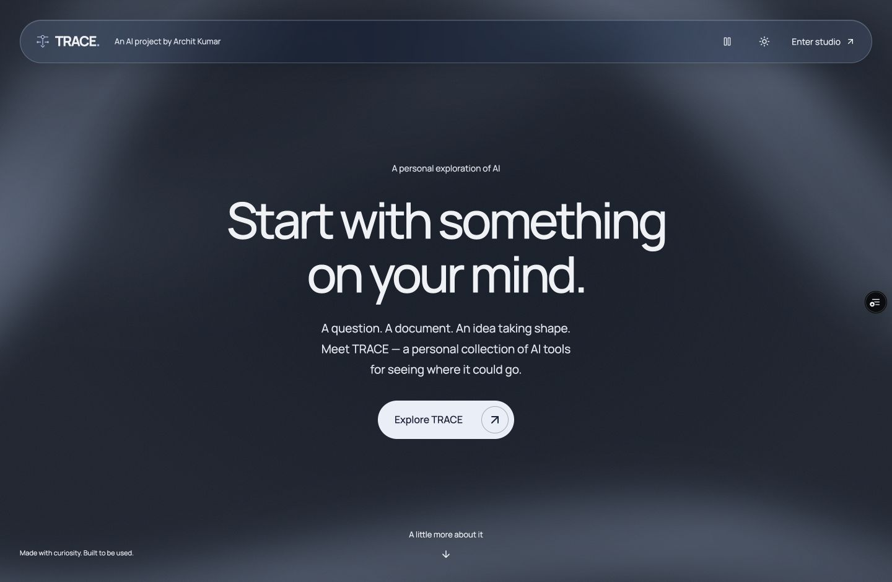
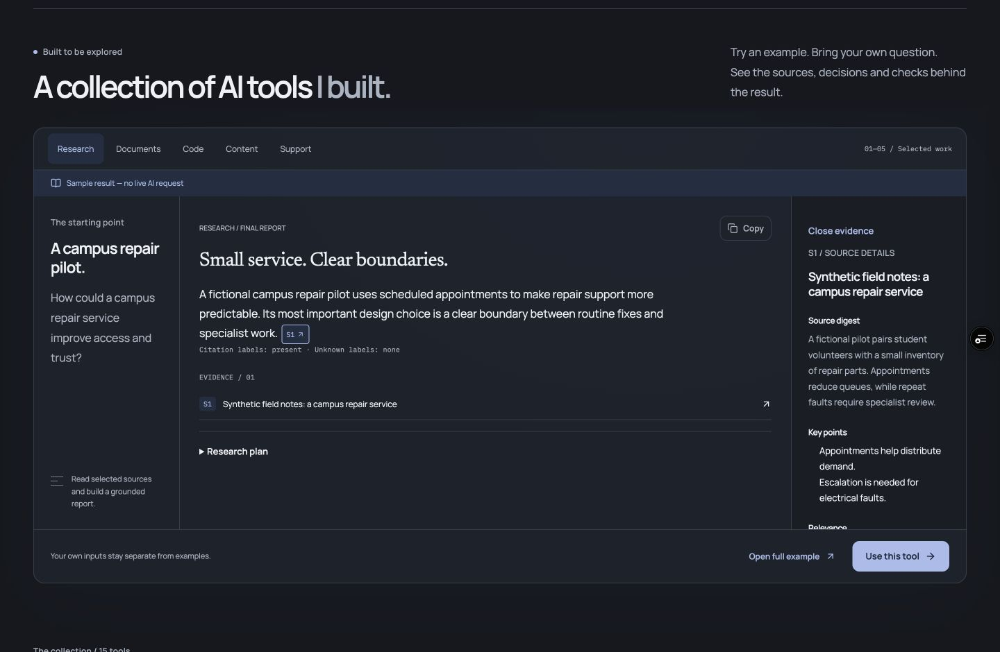
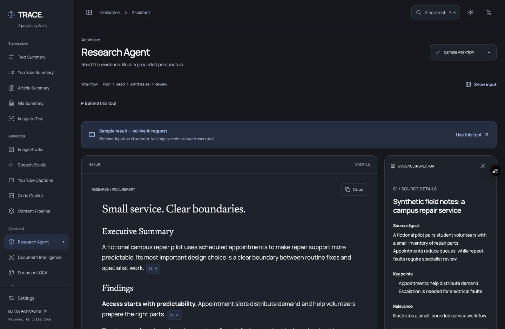
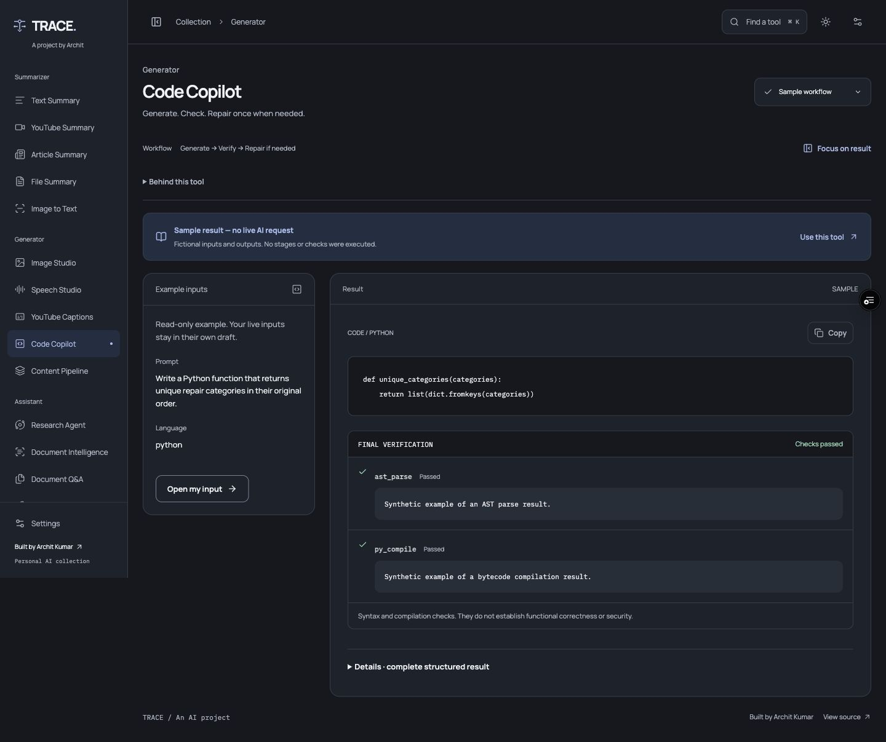
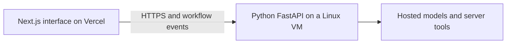

# TRACE

**A personal collection of AI tools, built by Archit Kumar.**

Turn a document, question or rough idea into something you can work with. TRACE brings **15 tools** into one workspace for research, reading, code, images, speech and content—with sources, processing stages and available checks kept close to the result.

[Open TRACE](https://trace-agentic-workspace.vercel.app/) · [Documentation](#documentation) · [My portfolio](https://portfolio-updated-ak.vercel.app/)



## Why I built it

Working with AI often means moving between separate tools: one to read a PDF, another to draft a report, another to write code, and another to make an image. It is also easy to get an answer without understanding which source it used or what was actually checked.

I built TRACE to bring those workflows together and make their supporting information easier to inspect. A student can ask questions about a report. A developer can generate a function and see its syntax checks. Someone planning a small project can turn a brief into a script, captions and narration.

The project combines a React interface, a Python API, hosted and local inference, document retrieval, temporary storage and deployment. It is a working personal project with its tradeoffs visible.

## Explore TRACE

Open TRACE using the link above, then select **Explore TRACE** to enter the collection. Free access requires no visitor API key and uses shared capacity.

**A quick walkthrough:** select a Research citation, then open the full example to inspect its source. Try the Code example to see individual checks, or the Content example to switch between its artifacts. Documents and Support have examples too.

Every example says **“Sample result — no live AI request.”** Examples work without a backend, consume no generation quota, and leave live drafts untouched. Choose **Use this tool** when you want to enter your own input and start a live request.

## Fifteen tools, three workspaces

### Summarizer — make sense of the input

| Tool | What it does | Example use |
| --- | --- | --- |
| **Text Summary** | Condenses pasted text into a readable summary. | Find the key points in a long project update. |
| **YouTube Summary** | Summarizes an available video transcript; accepts a pasted transcript when URL extraction fails. | Review the main ideas from a lecture. |
| **Article Summary** | Extracts and summarizes a public article. | Read the essentials of a technical announcement. |
| **File Summary** | Extracts and summarizes a PDF or DOCX file. | Understand a proposal before reading it in full. |
| **Image to Text** | Uses OCR to extract text from an image, with an optional summary action. | Turn a photographed printed notice into copyable text. |

### Generator — give an idea its first form

| Tool | What it does | Example use |
| --- | --- | --- |
| **Image Studio** | Generates an image from a prompt, with an expandable preview. | Explore a visual direction for a project. |
| **Speech Studio** | Turns text into audio, with mode-specific voice choices and explicit playback. | Hear a short presentation script aloud. |
| **YouTube Captions** | Extracts readable transcript text, with a pasted-transcript recovery path. | Reuse a transcript as study notes. |
| **Code Copilot** | Generates Python, JavaScript, Java, C or C++; runs available syntax/compilation checks and permits one repair attempt when checks fail. | Draft a utility function and inspect its diagnostics. |
| **Content Pipeline** | Produces a plan, script, image prompts, platform captions, hashtags, review and optional narration. | Turn an event brief into a first content package. |

### Assistant — investigate and decide what comes next

| Tool | What it does | Example use |
| --- | --- | --- |
| **Research Agent** | Plans a report from supplied URLs, digests sources, drafts with citations, and reviews or revises the output. | Compare information across a few selected sources. |
| **Document Intelligence** | Returns a summary, classification, entities, action items and risks for uploaded documents. | Find explicit tasks and dates in a meeting record. |
| **Document Q&A** | Indexes PDF/DOCX files, retrieves relevant passages and answers questions with source context. | Ask what a policy says about a particular situation. |
| **Article Q&A** | Prepares selected URLs for questions and exposes the retrieved text. | Query a small collection of product documentation. |
| **Support / Triage** | Classifies a request, consults supplied support sources, and proposes an answer or escalation with evidence and a next step. | Identify when a refund question needs human review. |

Research and article tools use the sources you provide. They do not autonomously search the web. Full input contracts and the original OpenAI behavior are documented in [tool contracts](docs/tools.md); free/local behavior is documented in [free access](docs/free-access.md).

## A closer look

These are real screenshots of the current interface in **dark mode**. The result screens below show bundled synthetic examples, not live generation or a model-quality benchmark.

### Learn through a working example

The collection introduces the workflow through interaction. Selecting a citation reveals the supplied source digest and key points.



### Read the answer alongside its evidence

The Research workspace keeps the report and source inspector together. Focus mode gives the result more room while preserving the input.



### See exactly what a code check means

The Code workspace separates generated code from individual check results. A passed syntax check is not presented as proof of correctness or security.



## Three ways to run a tool

| Mode | Where the work runs | What to know |
| --- | --- | --- |
| **Free access — recommended** | Cloudflare Workers AI for hosted text, code and images; server tools for extraction, retrieval, OCR and speech. | Visitors enter no provider key. Capacity is shared, and the UI identifies fallback use and failures. |
| **Local inference on our server** | The project's backend, including a smaller CPU text model. | “Local” means the server, not the visitor's device. It can take several minutes, still fetches submitted URLs, and does not provide local image generation. |
| **Advanced — my OpenAI key** | The existing OpenAI-backed workflows selected explicitly in settings. | Uses the visitor's own key and provider allowance. The key stays in browser and request memory rather than persistent application storage. |

**Fallbacks are task-specific.** An unfinished free text stage can continue with the local model when hosted inference is unavailable. Images keep Cloudflare as their first provider; a configured private Hugging Face ZeroGPU worker can handle an explicit capacity rejection. Ambiguous image failures do not silently submit another generation. If neither image provider has capacity, TRACE preserves the prompt and reports the limit; availability after a reset is not guaranteed.

The Hugging Face worker is an **image-only fallback**, not a replacement for the entire backend. Read the [routing and safeguards](docs/huggingface-images.md).

## Engineering choices

- **Show observed work.** The API streams workflow events such as extraction, retrieval and review. The UI shows elapsed time and completed stages, without invented percentages or model-token streaming.
- **Keep evidence inspectable.** Free/local document Q&A combines semantic retrieval with keyword search and returns the selected chunks. Citations help inspect an answer; their presence alone does not validate its claims.
- **Protect work during exploration.** Live inputs, files, contexts and results stay in a tab-scoped store. Samples use separate read-only fixtures, including while a live request is running.
- **Make partial outcomes usable.** Source failures, unreadable files and missing narration stay visible alongside successful output. Full structured data remains available in **Details**. Interrupted requests are not automatically replayed.
- **Use deliberate interface motion.** The introduction has original moving SVG folds, a glass navigation bar and a pause control. Reading surfaces stay solid. Both themes, keyboard navigation and reduced-motion behavior are supported.
- **Bound public usage.** Expiring anonymous sessions, ownership checks, exact allowed origins, Turnstile verification and fair-use limits protect shared resources. URL fetching blocks internal-network destinations and validates redirects.

Uploads, generated media and indexes are session-owned and retained for at most **24 hours**, with explicit session clearing. API keys are not stored in SQLite or browser storage. Only the theme preference persists across browser sessions. Requests can send relevant input to the selected inference provider; server-local mode is a different routing choice, not a claim that the whole application runs offline.

## Architecture and stack



| Layer | Technology and purpose |
| --- | --- |
| Interface | Next.js 16.3.8, React 19.3.0 and TypeScript; Tailwind, Radix primitives, Motion and Lucide. Self-hosted Manrope, Newsreader and IBM Plex Mono. |
| API | Python 3.11 and FastAPI, typed request/result contracts, generated frontend API types and request-bound workflow events. |
| Free text and code | Cloudflare-hosted Llama 3.3 70B and Qwen 2.5 Coder 32B; a pinned Qwen 3.5 4B model through Ollama for CPU fallback. |
| Retrieval | BGE embeddings, FAISS and BM25 combined for free/local Q&A. The original OpenAI path retains its LangChain/OpenAI embedding integration. |
| Media and extraction | FLUX.1-schnell for images, Kokoro for free speech, Tesseract for OCR, and PDF/DOCX/article extraction tools. |
| Code checks | Python AST/bytecode checks, Node.js syntax checking, a JDK, GCC and G++. Generated programs are not executed. |
| Storage and runtime | SQLite, private files and mounted Docker volumes; pinned dependencies and model assets. |
| Hosting | Vercel for the frontend; Google Compute Engine for the Python API and private Ollama service; Caddy for HTTPS. |

**Why two hosting layers?** The backend needs persistent model files, document indexes, native utilities and longer-running CPU work. The current complete backend does not run unchanged inside Vercel functions. Its Google VM is funded by trial credits, not an indefinitely free hosting guarantee. See the [deployment guide](docs/deployment.md) for operation, recovery and hosting limits.

## Run locally

### Interface and examples only

Use Node.js 24, matching the repository's frontend CI. No provider credential or Docker setup is needed to explore the five samples.

```sh
git clone https://github.com/Archit-k20/Agentic-Workflows-GenAI-.git
cd Agentic-Workflows-GenAI-
npm ci --prefix frontend
npm --prefix frontend run dev
```

Open [localhost:3000](http://localhost:3000), then choose **Explore TRACE**. Live execution requires a configured backend.

### Add the backend

Run these commands from the repository root in a second terminal. Docker Engine/Desktop with Compose is required. The composition allows 8 GB for Ollama and 3 GB for the API; leave additional memory for the host. Model downloads take time and disk space.

1. If you have not configured the backend already, copy its example environment file:

   ```sh
   cp backend/.env.example backend/.env
   ```

   For hosted free access, add your own Cloudflare Account ID and Workers AI token to this ignored file. The Hugging Face fallback is optional. Follow the [owner setup guide](docs/free-access.md#owner-setup-for-local-development) for the remaining settings. Keep owner secrets out of `NEXT_PUBLIC_` frontend variables.

2. Start the services, install the pinned local model and warm the required assets:

   ```sh
   docker compose up -d --build
   docker compose --profile setup run --rm --build model-setup
   docker compose exec backend python -m backend.warmup
   ```

   Use the committed installer: a mutable `ollama pull` tag is not equivalent to the tested model profile.

3. Keep the frontend running. Its default API URL is `http://localhost:8000`. If necessary, configure `NEXT_PUBLIC_API_URL` using [frontend/.env.example](frontend/.env.example) as a reference. The [health endpoint](http://localhost:8000/api/v1/health) reports readiness and installed capabilities; a configuration flag alone does not prove provider access or model quality.

Public hosting also requires HTTPS, the real Turnstile configuration and exact origin/hostname allowlists. Those steps belong to the [deployment guide](docs/deployment.md), rather than the local sample setup.

## Verification and known limits

The interface verification record includes **28 passing frontend tests**, type checks and production builds. The broader layout check covered all fifteen forms at five widths in both themes. The backend has separate native AMD64/ARM64 CI and documented live checks for selected tools, session isolation, retrieval, speech and images. These are recorded results with specific scopes, not a guarantee for every possible input.

To run the frontend checks:

```sh
npm --prefix frontend run typecheck
npm --prefix frontend test
npm --prefix frontend run build
```

[CI configuration](.github/workflows/trace-checks.yml) · [Interface verification](docs/interface.md) · [Live verification](docs/verification.md) · [Model evaluation evidence](docs/evaluation/README.md)

Current limitations are part of the project:

- **Output quality still needs review.** Evaluations found unsupported claims and omitted details. Targeted checks have improved specific cases, but complete current-profile quality acceptance remains open. A model's review is not independent factual verification.
- **Free access has shared limits.** Hosted providers and the optional image worker can exhaust their allowances. The smaller CPU fallback is slower and less capable; a long content workflow has taken nearly ten minutes in a recorded test.
- **Sources can be unavailable.** Websites can block extraction, and YouTube transcripts may be missing or inaccessible. The YouTube tools retain a pasted-transcript alternative.
- **Images have precision limits.** A detailed live test produced a convincing scene but missed exact counts, clock time and hand details. Images are creative interpretations.
- **Checks have boundaries.** Syntax/compilation success does not prove behavior or security. Model confidence is not calibrated certainty. English is the evaluated language.
- **Some release checks remain open.** Independent-device upload/playback checks and full OS-level accessibility/performance validation are tracked separately. Interface improvements do not resolve model-quality or backend acceptance work.

The application deliberately has no accounts, permanent history, autonomous web search, token streaming or cancellation. Browser drafts are temporary; retain important outputs yourself.

## Repository map

```text
frontend/                    Next.js interface, samples and frontend tests
backend/                     FastAPI, providers, storage, tests and evaluation
workflows/                   Shared Python workflow functions
huggingface/image-fallback/   Private Gradio image worker
compose.yaml                 API, private Ollama and model setup
.github/workflows/           Frontend and native backend CI
docs/                        Setup, design, verification and screenshots
```

## Documentation

| Guide | Read it for |
| --- | --- |
| [Free access](docs/free-access.md) | Provider modes, pinned models, processing limits and owner setup. |
| [Image fallback](docs/huggingface-images.md) | Cloudflare-to-Hugging-Face routing, private worker setup and safeguards. |
| [Interface](docs/interface.md) | Current design, sample isolation, screenshots and presentation behavior. |
| [Architecture](docs/architecture.md) | Frontend boundaries, provider routing, event transport and session storage. |
| [Tool contracts](docs/tools.md) | All fifteen tool contracts and mode-specific behavior. |
| [Deployment](docs/deployment.md) | Vercel/backend configuration, HTTPS, recovery and hosting constraints. |
| [Verification](docs/verification.md) | Current release checks, live evidence and remaining work. |
| [Evaluation evidence](docs/evaluation/README.md) | Model runs, source-based findings and the limits of automatic scores. |

## What I want to improve next

The next priorities are a fresh source-reviewed quality evaluation of the current inference profile, broader real-document coverage, independent mobile testing, and lower CPU fallback latency. Longer-term work includes a sustainable hosting path beyond trial credits and a shared-storage design before considering multiple backend instances.

These are future directions, not capabilities claimed by the current release.

---

**Built by Archit Kumar** · [Portfolio](https://portfolio-updated-ak.vercel.app/) · [LinkedIn](https://www.linkedin.com/in/archit-kumar-aa6375259) · [GitHub](https://github.com/Archit-k20)

Found a reproducible problem? [Open an issue](https://github.com/Archit-k20/Agentic-Workflows-GenAI-/issues) with the tool, execution mode and steps. Keep credentials and private documents out of reports.
