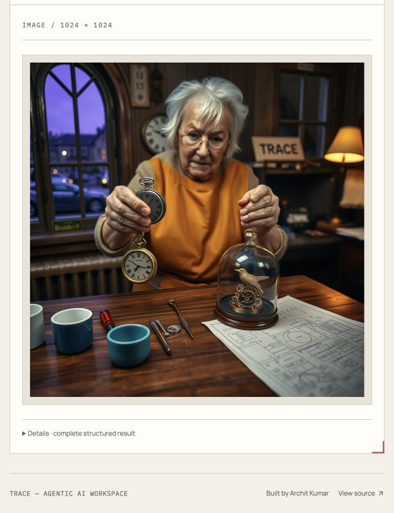

# TRACE verification — 11 October 2026

**Website:** https://trace-agentic-workspace.vercel.app

**API:** https://trace-api.34.93.169.35.sslip.io

**Deployed backend:** `926c6b688167f3d058685e808500e03e6fa0908a`

**Draft PR:** https://github.com/Archit-k20/Agentic-Workflows-GenAI-/pull/1

The application is live and visitors need no provider key. The approved editorial UI, Cloudflare primary image provider, private Hugging Face capacity fallback and optional OpenAI mode remain. **Complete output-quality acceptance is still open.** Deployment success, syntax checks and fact presence do not establish general accuracy.

| Delivery task | Status now |
| --- | --- |
| 1. Reproducible models/runtime | Complete; pinned native CI smoke remains passing |
| 2. Hosted quality | Partial; fresh corrected full cohort blocked by shared capacity, source inspection still required |
| 3. Local quality/capacity | Partial; simultaneous summaries pass, content source/latency limits remain |
| 4. Full Python/model hosting | Complete on existing Google trial VM |
| 5. Public Vercel/API connection | Complete; public access and protection verified |
| 6. Public integration acceptance | Partial; image/code/transcript recovery/DOCX/URL checks pass, broader live/device states remain |
| 7. Release/rehearsal | Documentation and draft PR updated; final quality/device gates and rehearsal still pending |

## Changes resulting from actual tests

| Before | Now | Verification |
| --- | --- | --- |
| Two simultaneous cold summaries could race while importing `AutoTokenizer`; one failed. | The shared CPU gate covers lazy imports and cached initialization of tokenizer and embedding model. | Two actual simultaneous HTTP/SSE summaries both succeeded, in 93.818/125.423 seconds. A third request received 429. Two unit tests cover concurrent cold factories. |
| Creative scripts could omit the explicitly named project owner or duplicate an almost identical refund sentence. | Owner details are retained; the observed missing-`only` sentence is replaced with the source sentence. Other paraphrases remain conservatively annotated rather than broadly rewritten. | Hosted content targets retained owners and final refund conditions. Conservative annotations can still duplicate differently worded conditions. |
| Research could call undocumented guarantees absent, and call shipment facts study findings. | Finite checks recognize more missing-evidence phrasing and study wording. Repairable draft wording reaches the existing review/revision sequence; a failing final report is rejected. | The conflict target on `1d5cca5` retained facts, citations and documentary uncertainty. The partial-source target remains unaccepted. |
| Summaries could invent a repeat count or assert an unknown guarantee's absence. | Free summary prompts distinguish missing documentation; final checks reject newly introduced numbers and specific absence claims. Document/research digests are checked within their existing structured repair. | Two fresh hosted summary targets completed without the observed count/absence mistakes. Document retests stopped on capacity. |
| A caught provider failure could appear as a research report missing every heading. | Free research exposes the actual generation failure. Original OpenAI empty-text fallback is preserved. | Paired free/OpenAI regression tests. Live hosted retest is pending capacity. |
| Local copy added that a project owner had “confirmed” shipping, although the source only named the owner. | The finite role check includes confirmation, auxiliary verbs and comma-separated names. | Real failure retained in the local report; positive/negative source tests pass. A fresh model retest of this last change is pending. |
| An unreadable YouTube response showed an XML/parser error. | A readable message recommends Paste transcript; the extraction stage finishes as failed, with the diagnostic retained. | Real browser retest showed the new message and retained URL. A separate pasted synthetic transcript returned unchanged in about one second. |

No workflow was automatically replayed, quota reset, paid overflow enabled, OpenAI key introduced or branch merged. Temporary diagnostic sessions were cleared.

## Complex public image test

One actual visitor/browser request generated a **1024×1024** image in about **21 seconds** using Cloudflare's `@cf/black-forest-labs/flux-1-schnell`. Hugging Face was not invoked because Cloudflare succeeded. Automatic visitor verification passed; earlier expired-session/verification clicks did not produce an inference result.

[Full prompt](evaluation/complex-image-prompt-2026-10-11.txt) and [visual rubric](evaluation/public-complex-image-2026-10-11.json).

| Requirement | Observed result |
| --- | --- |
| Clockmaker workshop, warm/cool lighting, wood/metal/glass | Strong broad scene and convincing materials |
| Legible TRACE sign | Matched |
| Exactly two cups / three aligned gears | Three cups; requested gear row absent |
| Watch in one hand, tweezers in the other | Extra hanging watch face; tweezers not visible in the hand |
| Wall clock at 6:15 | Not clearly matched |
| Mechanical bird / folded cyan blueprint | Partially matched |
| Five fingers per hand | Not verifiable from overlapping fingers |

This is a subjective review of one image: strong aesthetics, limited exact constraint following. It is unsuitable as proof of precise technical illustration or universally correct anatomy.

## Automated, browser and native checks

- **266 backend tests** passed locally and in the deployed AMD64 container, including original workflow parity, isolation/persistence, all fifteen adapters, finite source guards, and real five-language compilation/syntax checks. The test-only public-mode override applies only to the separate pytest process. Production visitor protection remains enabled.
- [Exact-source frontend/native AMD64/ARM64 CI](https://github.com/Archit-k20/Agentic-Workflows-GenAI-/actions/runs/38126494880) is green, including real pinned embedding/index/speech and local inference smoke checks.
- **18/18 public HTTP wiring checks** passed after the latest deployment: readiness, exact CORS, visitor protection, installed capabilities and missing-proof rejection. These checks do not perform inference.
- All fifteen public entry forms were checked at **360, 768, 1024, 1440 and 1920 px**, in both themes: **150 checks**, without page-level horizontal overflow. A code sample also passed five widths. This does not cover every long report, error, success, upload or inspector state.
- A real public Python Code Copilot request returned in about **6 seconds**, via hosted Qwen Coder, with actual AST/bytecode checks passing. Four separate local assertions passed for that specific generated function; this is not general behavioral/security certification.
- Actual production HTTP routes accepted a synthetic DOCX with its long filename retained and built a BGE/FAISS context in **3.043 seconds**. Its answer retained owner, quantity, date and [S1] in **28.931 seconds**. A real official Python URL context built in **0.299 seconds** and produced a cited answer in **22.894 seconds**. These used transient owner-issued sessions, not browser file picking or independent-network proof; both sessions were cleared. Cross-session DOCX query returned an SSE error without a result/source. Both default free-mode answers explicitly used local fallback; see their recorded execution metadata.
- Keyboard command search opened with Cmd+K, searched Code, navigated using Tab/Enter and closed on Escape. This is a focused keyboard test, not a complete accessibility audit. Reduced-motion CSS/Motion branches were inspected; actual OS preference testing and field LCP/CLS/INP remain open.
- During concurrent local summaries, sampled API/Ollama usage was approximately **315 MiB/3.74 GiB**. During the local content target, approximately **307 MiB/3.97 GiB** was observed, with no OOM/restart at that snapshot. These are samples, not measured memory peaks or heavy-workflow stress certification.

Evidence: [public wiring](evaluation/public-wiring-final-2026-10-11.json), [forms](evaluation/public-layout-2026-10-11.json), [code](evaluation/public-code-2026-10-11.json), [transcript recovery](evaluation/public-captions-2026-10-11.json), [clarified transcript error](evaluation/public-youtube-fixed-2026-10-11.json), [actual DOCX/URL contexts](evaluation/public-contexts-2026-10-11.json), [initial concurrency failure](evaluation/vm-concurrency-2026-10-11.json), [separate passing concurrency retest](evaluation/vm-concurrency-fixed-2026-10-11.json).

## Model evaluation and remaining gates

Different inference profiles have separate reports and fingerprints; they must not be merged into a purported current-profile sixty-case pass.

[Source-based review, report hashes and limitations](evaluation/release-review-2026-10-11.json) records inspected findings separately from automatic fact-presence scores.

| Report | Result | Limit |
| --- | --- | --- |
| `hosted-targets-2026-10-11.json` | Seven real successful executions on `3529b10` | Source review exposed omitted owners/absence wording |
| `hosted-release-2026-10-11.json` | 45 successful executions, one research rejection; stopped after 46 attempts on `d57b55` | Summaries/digests still contained misleading absence wording; a long summary invented “31 times”; not a quality pass |
| `hosted-followup-2026-10-11.json` | Conflict case completed; partial-source case failed final source checks on `87987ca` | Conflict output still described an undocumented study |
| `hosted-final-targets-2026-10-11.json` | Nine of twenty targets completed on `1d5cca5`: one conflict report, six code cases across five languages, two summaries | Eleven failed/incomplete stages; shared allowance prevented larger follow-up stages. A caught empty report produced misleading structure errors, subsequently corrected in transport. No fallback was counted as hosted success |
| `local-final-targets-2026-10-11.json` | One real CPU content execution completed in **592.64 seconds**, with all expected facts | Owner confirmation was invented; differently phrased refund condition duplicated; review correctly remained failed. Subsequent confirmation guard needs fresh model evidence |

Hosted reservations are conservative shared application estimates, not Cloudflare's billing totals. A large report stage may be rejected while a smaller code/summary request still fits. Preserve budgets; reset at 00:00 UTC / 05:30 IST does not guarantee provider availability.

Next quality run: prioritize partial-source research, owner-confirmation content and the two document targets after capacity becomes available. Then run a fresh full sixty-case profile with separate source inspection. Do not relabel historical passes or spend the full allowance immediately before the interview. Advanced OpenAI live acceptance still requires an explicitly supplied test key; none was used here. Successful public-browser Hugging Face fallback remains distinct from the earlier two real private/operator HF generations.

The owner is checking independent phone/mobile-data file selection, supported PDF answer and speech playback. Broad long-output/reduced-motion/accessibility/performance acceptance and remaining varied real public tool paths are still open.

## Hosting and interviewer rehearsal

Vercel Hobby hosts the frontend. The full Python backend and private Ollama run on the existing Google **Compute Engine Free Trial VM**, not Vercel functions. The observed trial end is **8 January 2027** or earlier credit exhaustion; this is not permanent free hosting. No paid upgrade occurred. See [recovery and hosting](deployment.md).

For a short interview, open the public home, explain the five clearly labeled samples, then use a small document question, short speech and Code Copilot request. One image makes a useful visual example; show its limitations honestly. Demonstrate citations, review status and syntax checks without calling them factual/security certification. Use the complex image already generated if the image allowance is exhausted. Avoid CPU Content Pipeline during a short presentation: the observed fallback took nearly ten minutes.

The project is reviewable on the draft branch; final quality/device gates remain separate from being live. The approved UI design was not redesigned in this verification pass.
